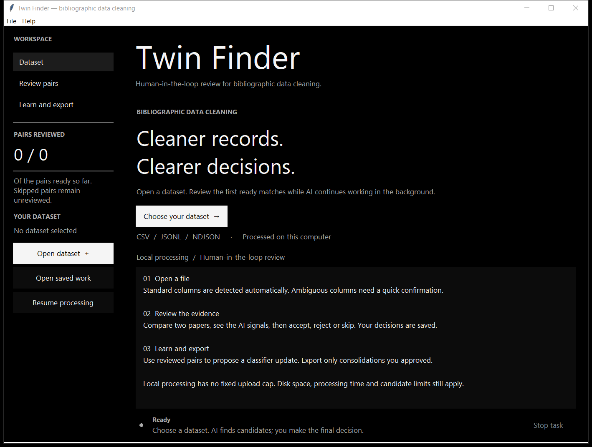
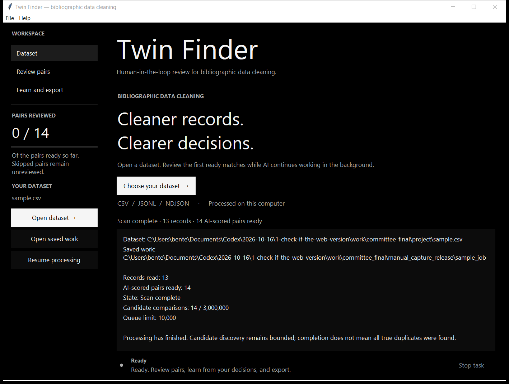
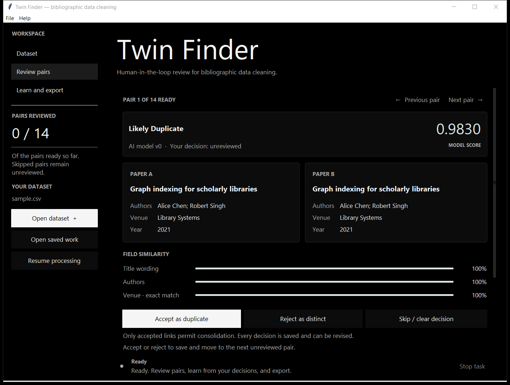
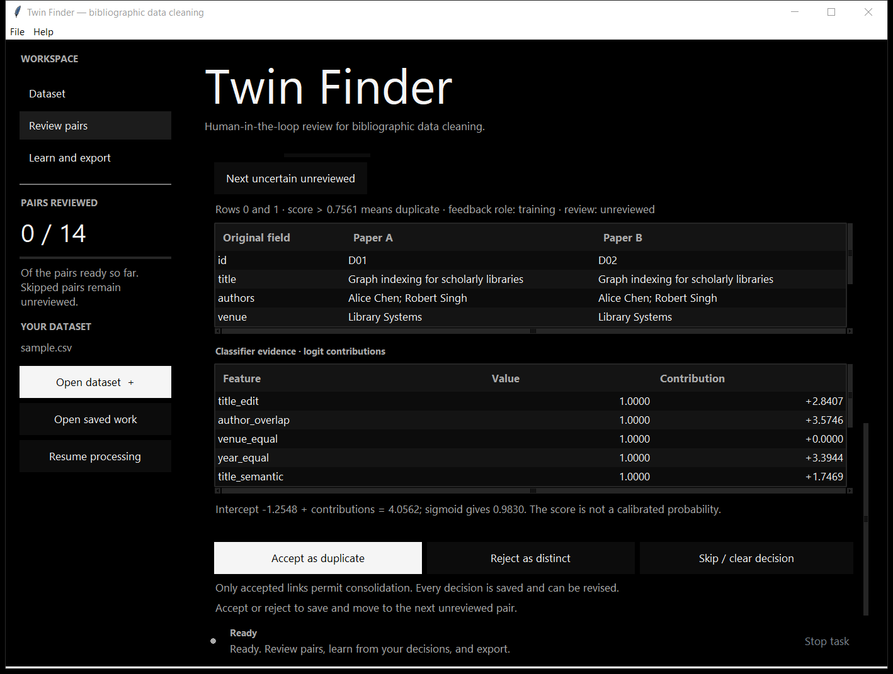
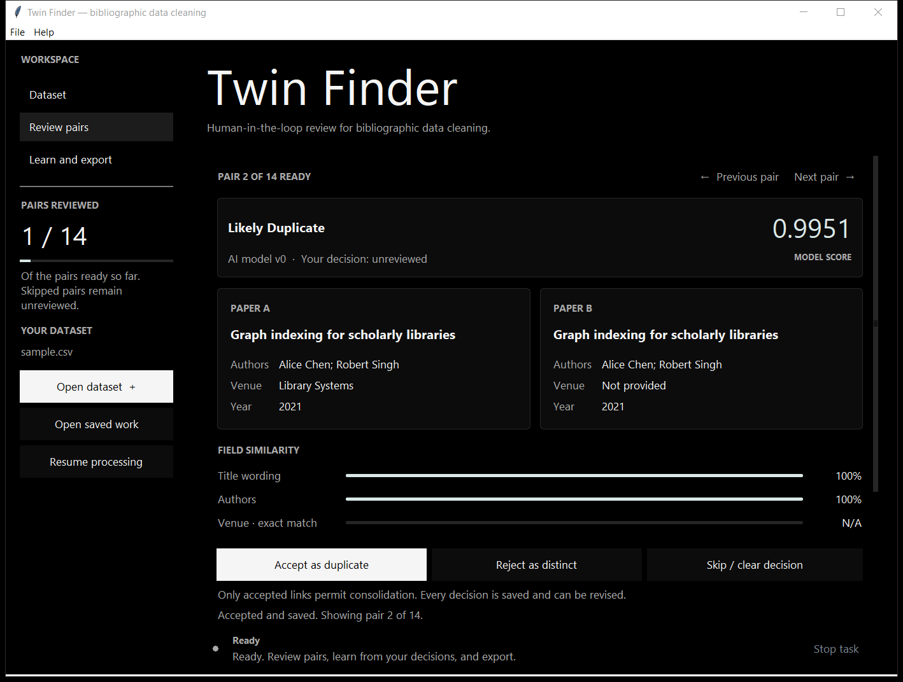
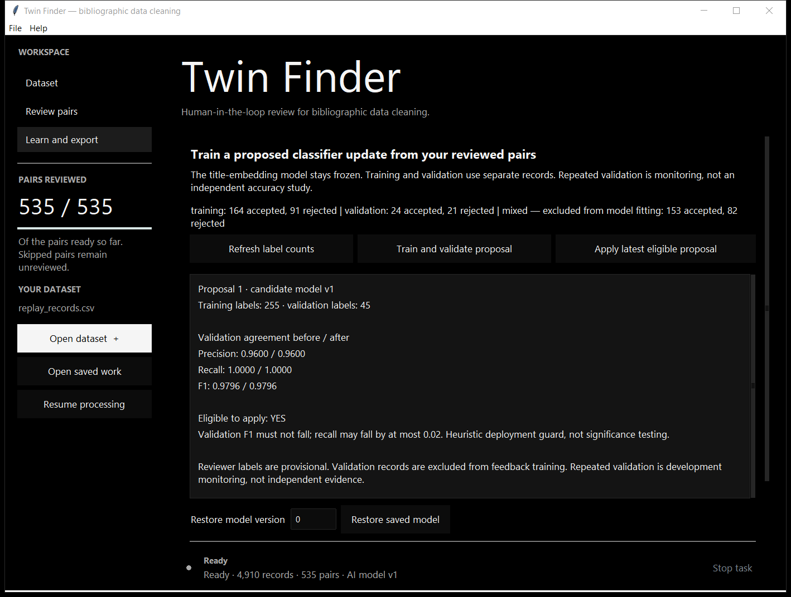
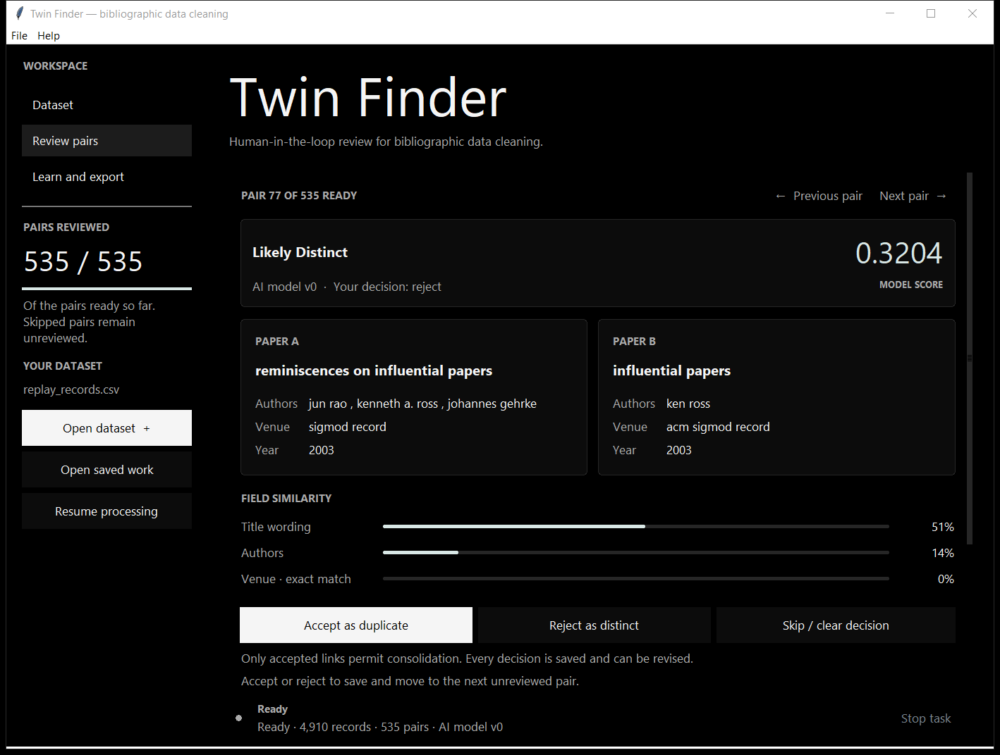
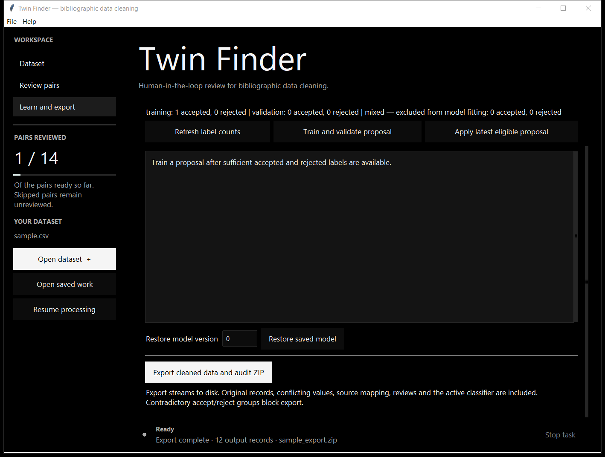

# Twin Finder user manual

This manual covers the progressive desktop application. It proposes publication matches using a neural title encoder and a learned metadata classifier. You decide which records may be consolidated. Source records and conflicting values are preserved in the exported audit archive.

The interface uses a black background, an enlarged Twin Finder heading and a centered workspace on wide displays. Source launch and the Windows package declare DPI awareness so Windows need not enlarge a low-resolution rendering of the whole window. The previous blanket font override has been removed. Restart the application after updating; an already-open window retains its previous rendering. Layout checks cover simulated 100%, 125% and 150% text scaling; this is not a claim that every monitor or mixed-DPI configuration was visually tested.

## 1 Open a dataset

Start the application with `python desktop.py` from its installed environment, or open the packaged executable. Choose **Open dataset** and select a UTF-8 CSV or flat JSONL/NDJSON file. Title is required. Standard title, author, venue and year column names are detected automatically. A confirmation dialog appears only if a required column is missing or names are ambiguous; optional absent fields are left unavailable.

The app creates a working folder automatically beside the source, under `TwinFinderJobs`. The Dataset tab shows its exact location. Choose a source location with sufficient free disk space for the database, indexes, cached AI features and exports. Each input record is limited to 8 MiB and 256 fields. JSON arrays and nested objects require conversion first.

For a first demonstration, open the supplied `sample.csv`. This is a synthetic 13-record teaching fixture, not a sample from arXiv or a recorded human study. D01/D02/D03 describe one publication with missing or varying metadata. D07/D08 represent a workshop and journal version that the fixture intends to retain separately. Read the evidence and apply the intended catalogue policy.

## 2 Begin reviewing while processing continues

Use the left sidebar to move between **Dataset**, **Review pairs**, and **Learn and export**. The Dataset page displays the first five imported titles as a preview. As soon as scored pairs are available, the app opens **Review pairs**. It builds a buffer of approximately 50 unreviewed pairs and replenishes it between import batches as you review. After reading the file, it scores the remaining selected queue up to the configured limit. No waiting for all titles to be encoded is required before the first review.

The banner distinguishes scanning, paused work and scan completion. Early results are partial. New pairs are appended; an existing pair number never changes identity. Candidates can link records from different input batches. Scanning is bounded, so completion does not establish that every duplicate was discovered.

Default limits are 10,000 ready pairs and 3,000,000 candidate comparisons. File → Processing limits changes the queue limit for new datasets. Up to three eligible rare title-token blocks and 32 prior candidates per incoming record are considered. Unscored candidates from different nonempty `source` values receive scheduling priority when that provenance column exists. Source provenance does not assign a duplicate label. The unscored reservoir is capped at 100,000 pairs. The application reports limits reached.

## 3 Inspect evidence and record your decision

The Paper A and Paper B cards show titles, authors, venue and year using the dataset's confirmed column mapping. Cards sit beside each other on wider windows and stack in smaller windows. Five similarity bars show title wording, author overlap, exact venue/year agreement and neural title similarity. N/A denotes an unavailable comparison, rather than a zero similarity. These percentages describe individual feature values, not confidence. The separate model score is the actual classifier output; a score of 0.90 is not a claim of 90% certainty. **Review needed** indicates proximity to the model threshold, not a separate learned class.

Expand **AI details and navigation** for all original fields, the ten classifier features and their contributions to its logit. The displayed formula reconstructs the model score. Unusually long values are shortened on the cards and remain complete in the original-field table and source data.

Choose **Accept as duplicate**, **Reject as distinct**, or **Skip / clear decision**. These actions stay visible below the scrolling evidence. Accepted links authorize future consolidation; rejected links retain distinct records. Skip clears the current decision while preserving the audit history. The sidebar counts current accepted/rejected pairs against the queue ready so far; revisions do not count a pair twice and skipping removes it from the reviewed count. The denominator can grow during processing.

Accept, Reject and Skip save first, then automatically show the next unreviewed pair in queue order. Already accepted/rejected pairs are bypassed; after reaching the end, navigation returns to earlier undecided pairs. Skip keeps a pair undecided. Saving runs in the background, with decision buttons temporarily disabled and a short double-click guard. A failed save keeps the current pair visible and displays **Decision not saved**; retry only after resolving the reported problem. A successful save followed by a display failure is reported separately.

Use **Previous pair** or **Next pair** above the cards to revisit decisions. At the last ready pair, the app shows completion or waiting status instead of an out-of-range error. When processing is still incomplete and no other undecided pair is ready, the app automatically opens newly published pairs. If processing is paused, choose **Resume processing**. Reopening saved work starts at the first unreviewed pair. Expand **AI details and navigation** to jump to a pair number, choose **Show pair**, or use **Next uncertain unreviewed**. Its role filter applies only to uncertainty navigation, not normal automatic advance. Mixed-role pairs are reviewable but excluded from feedback fitting.

Review stays available during scanning. No machine score alone merges records. Read the titles, authors, venue and year; related publications and same-title works can still be distinct.

## 4 Pause and resume

Choose **Stop task** to pause at a safe checkpoint. The current batch may need a moment to finish. Closing during work requests safe cancellation before the window closes. Reopen the folder with **Open saved work**, or use **File → Recent datasets**, then choose **Resume processing**. Keep the source file at the same path with unchanged contents and modification time until processing completes.

The animated ring at the bottom shows that a task is running, alongside elapsed time and the latest task message. It is an activity indicator, not an estimated completion percentage. The sidebar progress bar measures human review only. Review remains usable while scanning continues.

New jobs save import and candidate discovery at 250-record checkpoints. Completed scored pairs and all review events survive resume. The previous desktop version's jobs can also be opened; their saved decisions and model versions are retained. Its legacy import/candidate preparation remains compatible, with its original checkpoint behavior and faster variable-padding inference. Open the source as a new dataset to use the progressive pipeline.

Do not delete job databases or lock files. A second scanner is refused. Short transactions serialize review and background writes; same-process writes wait in arrival order. If a busy-job error persists, finish or close any other Twin Finder instance using that job, then retry. Do not delete a lock file or discard your saved work. A changed source is rejected rather than silently continuing with inconsistent data.

## 5 Learn from your reviewed pairs

Pause processing, or wait for completion, before choosing **Learn and export → Train and validate proposal**. First use **Refresh label counts**. At least eight accepted and eight rejected training pairs, plus four accepted and four rejected validation pairs, are required. The small teaching sample cannot satisfy these minima. Do not invent labels to enable training.

The small classifier learns; the neural encoder remains frozen. Feedback records receive stable training or validation roles within a job. Mixed-role pairs are excluded. The proposed threshold is selected on training feedback. Validation F1 must not fall, and recall may fall by at most 0.02. These are engineering safeguards, not proof of generalization or reviewer correctness.

Inspect the before/after results and choose **Apply latest eligible proposal** only if appropriate. New labels or a different active model make an old proposal stale. Revisit a pair to see the changed model version and score. This explicit activation closes the feedback loop. **Restore saved model**, with version zero, returns to the job's initial model. Rollback preserves review history and does not undo an already exported file.

For a reproducible simulated demonstration, install the research dependencies and run:

```powershell
python research/feedback_demo.py --work C:\TwinFinderJobs\feedback_demo
python desktop.py --job C:\TwinFinderJobs\feedback_demo\job
```

Use a new working folder. This script replays benchmark labels; it is not a librarian study, a fresh accuracy test, or proof of improvement. Its saved predictions identify the changed decisions.

## 6 Export reviewed cleaning

After the scan completes, choose **Export cleaned data and audit ZIP** and a new output filename. Export is blocked during incomplete import so a partial source is not mistaken for a complete cleaned catalogue. A completed bounded scan can still omit possible duplicate pairs; unreviewed records are retained.

The ZIP includes cleaned records, original records, source-to-output mappings, conflicting field values, review history and the active classifier. Accepted connected components are consolidated using the most complete representative and missing-value filling. If accepted links connect a pair explicitly rejected as distinct, export stops until the contradiction is resolved. Inspect representative outputs before using them in a production catalogue.

## 7 Diagnostics, timing and limits

Choose **Help → Run diagnostics** while idle to check the neural model. A successful result reports dimension 384 and a diagnostic JSON path. This tests the runtime, not your dataset's quality.

On the measured 66,879-record DBLP–Scholar input, the new pipeline reached its first scored pairs in 3.22 seconds, passed 50 pairs in 4.35 seconds, and completed the selected 10,000-pair queue in 74.94 seconds. These are one-run measurements on this computer, excluding application startup and the file dialog. Reading a different file, finding few matches, slower disks or system load can change the timing. Full processing of arbitrary huge files is not promised in seconds.

The app opens local files and has no browser upload-size cap. Available RAM, disk space, processing time and review volume remain finite. The illustrations below are actual windows rendered by this version. They were captured by an isolated application test harness, not copied from arXiv or the retired web application. They are scripted operating examples, not observations from a human study. Full-resolution PNGs and capture provenance are supplied in docs/screenshots/.

## 8 Illustrated walkthrough

Run the application, choose Open dataset, and select sample.csv from the supplied project. This fixture contains 13 synthetic records. Keep the original file in place while processing. Standard columns are detected without a mapping step. For an unfamiliar file, inspect the proposed mapping before confirming.



Figure A1. Actual startup screen. Open dataset starts the local workflow; Open saved work resumes an existing job.

Once processing finishes, select Dataset to check the record count and exact saved-job path. Scroll inside the information box to see the first five imported titles. A completed scan means the configured bounded search finished; it does not guarantee that every duplicate was found.



Figure A2. Synthetic sample after import, showing its saved-job details. The preview appears farther down in the scrollable information box.

Select Review pairs. Compare the two publication cards, then scroll the central evidence area to read all five similarity bars. Read the model score as a classifier output, not a certainty percentage. Similar-looking titles may still describe different publications.



Figure A3. Synthetic D01/D02 pair with real neural inference and the learned base classifier.

Expand AI details and navigation. The original-field table preserves the source values. The contribution table shows the classifier inputs, and the formula reconstructs its score. Scroll inside either table to inspect rows not currently visible. These are classifier explanations, not explanations of neural tokens.



Figure A4. Expanded original fields and additive classifier evidence for the same synthetic pair.

For this teaching pair, choose Accept as duplicate. Wait for the saved notice. The application automatically opens the next unreviewed pair; Reject as distinct follows the same save-and-advance sequence. Use Previous pair to revisit and revise a decision. Skip leaves it undecided. If saving fails, the app stays on the pair and identifies the problem.



Figure A5. The actual scripted acceptance has been saved and pair 2 is now displayed. No source records are deleted by this action.

The sample is too small for learning. To demonstrate the full loop, run the feedback_demo command in the learning instructions above in a NEW folder, then open its job. This deliberately replays 535 benchmark labels. In Learn and export, refresh the counts and inspect the saved proposal. Scroll its result box to read the validation metrics and eligibility. For your own sufficiently labeled job, Train and validate proposal computes this result; Apply latest eligible proposal activates it only after your explicit choice. Do not relabel pairs merely to satisfy the minima.



Figure A6. Actual replay proposal and feedback counts: 255 training, 45 validation and 235 mixed-role pairs. The saved demonstration leaves model version 1 active. The eligible flag describes the original proposal evaluation; trying to apply it after the active model or labels change is refused as stale.

To verify that feedback returns to analysis, select Restore model version 0 and choose Restore saved model. In Review pairs, expand AI details and navigation, enter pair 77 and choose Show pair. Note its model version and score. Return to Learn and export, restore saved version 1, and revisit the same pair. The two captures below show that exact replay pair under the two saved classifiers. The Review Needed banner indicates proximity to the threshold; expand the details to see the threshold and actual score. A changed classification need not be a correction.



Figure A7. Replay pair 77 under classifier version 0. Its saved reviewer decision is retained independently of the model.


Figure A8. The same pair under classifier version 1. The score and threshold have changed through the implemented feedback cycle. This example demonstrates changed behavior, not improved accuracy.

Return to the sample job with Open saved work. After scan completion, choose Learn and export → Export cleaned data and audit ZIP, select a new filename and wait for completion. Open the ZIP and inspect the cleaned records, originals, mapping, conflicts, review events and model state. The accepted sample link produces 12 output records from 13 inputs. Unreviewed records remain. Resolving a rejected-link contradiction requires revisiting the relevant reviews before exporting again.



Figure A9. Actual successful sample export after one accepted duplicate link. This is a teaching export, not a cleaned benchmark used to claim accuracy.

All nine images can be reproduced on Windows after installing the research dependencies:

```powershell
python research/capture_manual.py --work C:\TwinFinderJobs\manual_capture --feedback-job C:\TwinFinderJobs\feedback_demo\job --output docs/screenshots
```

Use a fresh work folder. The harness copies the feedback job and creates a separate sample job; it never edits your original research or review jobs.
